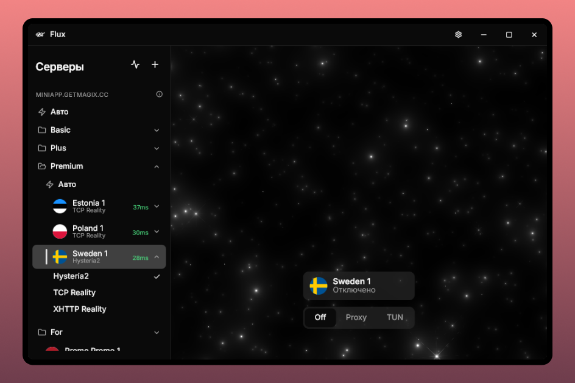

<div align="center">
  

  # NN4K

  A Windows VLESS / Hysteria2 client, derived from Flux and built with Flutter.
</div>

<br />

<div align="center">
  
</div>

## What it is

NN4K is a Windows-focused fork of
[Flux](https://github.com/fllcker/flux-vpn-client), powered by
[xray-core](https://github.com/XTLS/Xray-core) (and, on Windows TUN mode, a
[sing-box](https://github.com/SagerNet/sing-box) routing bridge alongside it).
It reads a "Magic JSON" profile — subscription URLs and/or standalone servers
— and gets you connected with a couple of clicks, either through a local
system proxy or a Windows TUN tunnel. Existing Flux data remains in
`%AppData%\flux` for compatibility; the Windows executable is `nn4k.exe`.

This fork's release workflows build **Windows only**. Inherited Android/macOS
code is not covered by the Windows release or the current audit.

## Killer features

- **Server groups, not just a flat list.** Subscriptions auto-group into
  folders (by name, by tag — however the subscription itself organizes
  them), and you can drag-and-drop servers/groups to reorder or regroup by
  hand — manual layout survives subscription refreshes instead of getting
  wiped every time.
- **Routing rules per server or in bulk.** Send specific domains/IPs direct
  or block them, either on one server or applied across an entire
  subscription at once — no need to repeat the same rule 30 times.
- **"Magic JSON" profiles.** One JSON format covers subscriptions and
  standalone servers together, so sharing/backing up your whole setup — not
  just one link — is a single file. See `docs/` for the format.
- **Auto-pick-best-server.** Ping every server (through the proxy, raw TCP,
  or ICMP) and let Flux pick the lowest-latency one instead of guessing.
- **In-app Windows updates.** Check, download and install from this fork's
  public releases without an account, repository setup or token. The publisher
  is pinned at build time. Automatic installation is opt-in and waits until VPN
  is idle.
- **DNS diagnostics under Ping.** After confirmation, sequentially test seven
  public resolver pairs, choose a reliable encrypted primary/backup and save it
  for later starts. [Selection and privacy details](docs/DNS_DIAGNOSTICS.md).
- **Six repaired playful tools.** Clickable and keyboard-accessible flashlight,
  recorder, DOOM, calculator, Minecraft and offline video parodies. All controls
  use local UI state only; no microphone, game process or online player.

## Other features

- **Protocols**: VLESS (TCP, XHTTP, TLS, Reality) and Hysteria2.
- **Subscriptions**: import by URL, auto-refresh, auto-grouping.
- **Connection modes**: system proxy or TUN tunnel on Windows. TUN requires
  administrator privileges; installing or updating the application does not.
- **Tray icon, autostart, and window state** on Windows.
- Dark theme, Russian/English localization.
- Original first-run setup: background, language, autostart and an interactive
  server-list guide. It can be repeated from Settings; the updater does not
  replace the existing UI or reset appearance preferences.

## Platforms

| Platform | Status |
| --- | --- |
| Windows x64 | Release target; see [build and validation notes](docs/WINDOWS_BUILD.md) |
| Android / macOS | Inherited code; not released or validated by this fork |
| Linux / iOS | Not supported by this fork's build workflows |

The Windows package targets an **AMD64/x64 Windows OS**, not 32-bit Windows or
ARM64 emulation: the bundled Wintun driver must match the OS architecture.

The core is deliberately built around a platform-agnostic `CoreEngine`
abstraction (config format, routing, subscriptions — all shared), so the
remaining platforms are "write the platform-specific engine glue", not "port
the app" — see `PLAN.md`.

## Download

Use [**Releases in this repository**](https://github.com/maksoon4k/nn4kvpn/releases/latest), not the upstream Flux download page.
Downloads and in-app checks are public; a GitHub account or token is not needed.

- `NN4KSetup-<version>.exe`: per-user installer.
- `NN4K-<version>-windows-portable.zip`: extract and run `nn4k.exe`.
- `checksums.txt`: SHA-256 hashes of both files.

The packages retain [component notices and corresponding source links](THIRD_PARTY_NOTICES.md),
including full GPL/MPL terms; each bundled core's tagged source is available
without an account or charge.

The published **[v1.4.4](https://github.com/maksoon4k/nn4kvpn/releases/tag/v1.4.4)**
adds token-free updates, repaired tools and DNS diagnostics. Its exact CI packages
passed **383 tests**, **23 publishing guards**, **15 DNS schemas** and both strict
startup modes; all public downloads were independently verified without an account.
See the [release validation record](docs/WINDOWS_RELEASE_1_4_4.md),
[changelog](docs/changelog/changelog-1.4.4.md) and
[qualified review](docs/SECURITY_AUDIT.md) for the scope and untested behavior.
The earlier [v1.4.3](https://github.com/maksoon4k/nn4kvpn/releases/tag/v1.4.3)
and its [validation evidence](docs/windows-release-validation.json) remain
unchanged; published binaries are never replaced with a rebuild.

The CI runtime needs a compatible **Microsoft Visual C++ v14 x64 Redistributable**
if it is not already installed; use
[Microsoft's official guidance](https://learn.microsoft.com/en-us/cpp/windows/latest-supported-vc-redist).
Windows N/KN also needs the appropriate **Media Feature Pack**. These system
prerequisites are not bundled and may need admin rights to install; NN4K's own
installer remains per-user. Clean-machine compatibility remains untested.

No Authenticode signing is configured. Windows may show an unknown-publisher
or SmartScreen warning. A matching checksum verifies integrity against the
trusted release metadata; it does not prove that a program is safe.

Release publication is draft-first: the publisher verifies every uploaded
asset's size and SHA-256 before publishing. Published versions must not be
overwritten.
See [Windows updates](docs/WINDOWS_UPDATES.md).

## Building from source

Requires Flutter **3.50.1**, Visual Studio with Desktop development with C++,
and a Windows SDK with x64 tools/libraries. Packaging uses Inno Setup **7.1.1**.

### Windows

```powershell
./scripts/fetch_xray.ps1       # downloads xray-core into assets/xray/
./scripts/fetch_sing_box.ps1   # downloads sing-box into assets/sing-box/
flutter pub get --enforce-lockfile
flutter analyze --no-pub --no-fatal-infos
flutter test --no-pub
flutter build windows --release --no-pub --dart-define=NN4K_UPDATE_REPOSITORY=maksoon4k/nn4kvpn
```

For a different public fork, replace `maksoon4k/nn4kvpn` with its repository slug.
Only that slug is compiled in, **never a GitHub token**. Omitting the define pins
this fork's default publisher; imported settings cannot redirect executable
updates, and the application has no repository/token configuration UI.

After building, package with `./scripts/build_installer.ps1 -SkipBuild
-IsccPath <path-to-ISCC.exe>`. See [Windows build notes](docs/WINDOWS_BUILD.md)
for disk placement, SDK discovery, validation and release instructions.

### Security and licensing

Read the [qualified security review](docs/SECURITY_AUDIT.md) before use. It
describes fixes, evidence and remaining risks; it is **not a backdoor-free or
complete-security certification**. Do not test live Proxy/TUN modes as part of
the automated smoke check.

The supplied upstream tree has no top-level license, and GitHub reported no
recognized upstream license during this review. The maintainer confirmed the
original author's permission for this public source/Windows distribution.
That confirmation does not create a blanket open-source license for upstream
code; do not assume MIT or another license. Required attribution and component
license texts are preserved in [THIRD_PARTY_NOTICES.md](THIRD_PARTY_NOTICES.md)
and in Windows packages.

## Tech stack

Flutter (Dart) UI with a hand-rolled shadcn/ui-inspired widget kit
(`lib/widgets/port_ui/`), Riverpod for state, and native platform code where
the engines live: `window_manager`/`tray_manager`/Win32 registry on Windows,
a Kotlin `VpnService` + Go-bound xray-core on Android.

## Roadmap

Development notes, design decisions, and what's next live in
[ROADMAP.md](ROADMAP.md).
